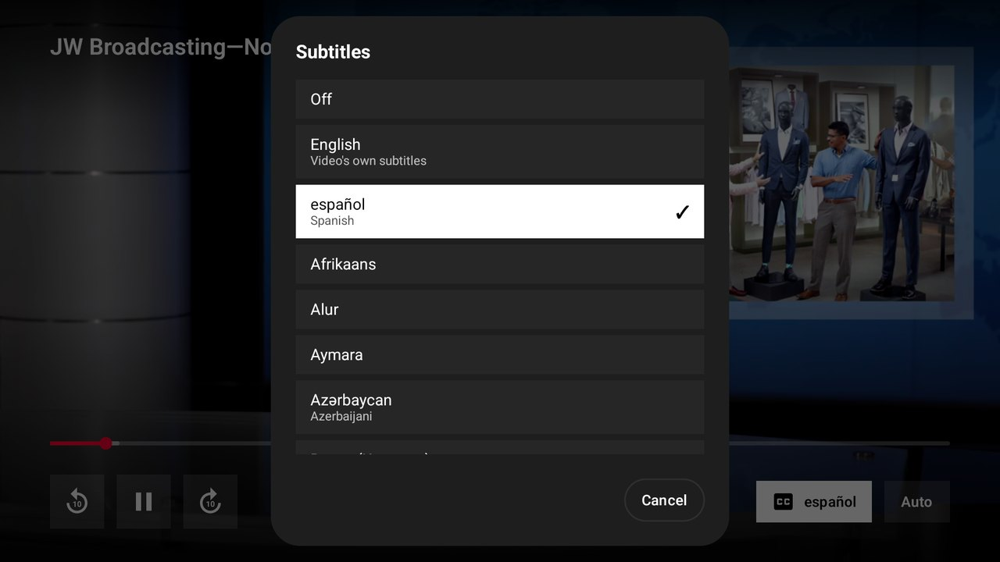

# JW TV

Watch the JW.org video library on your TV, with a fast interface made for the remote.

  

## Subtitles in any language

Watch any video with subtitles in **any language it's published in**, not just the language of the video. For example, English video with Spanish subtitles, or Spanish video with English subtitles.

Press **CC** in the player and pick from Off, the video's own language, your recent languages, or the full list. Your choice is remembered for the next videos, and you can set it in **Settings** too.

  
  

## Features

- **Browse the library**: Studio, Children, Family, Bible, Movies, Series and more
- **Continue watching**: pick up where you left off, or start over
- **Downloads**: save videos for offline viewing and manage storage
- **Quality**: choose the resolution, up to 2160p
- **Favorites**: keep a personal list
- **100+ languages**: switch the library language in Settings
- **Updates itself**: new versions are offered inside the app

  

## Download

Get the latest APK from [Releases](https://github.com/madroots/jwtv/releases): `app-release.apk` for TV, `app-phone-release.apk` for phones. Installed apps update themselves.

## Releasing

Publish a GitHub release with a higher tag, e.g. `gh release create v3.9.15 --generate-notes`. The [Release workflow](.github/workflows/release.yml) builds both apps and attaches the APKs and version files; installed apps then offer the update with the release notes.

- `vX.Y.Z` sets versionName `X.Y.Z` and versionCode `X*10000 + Y*100 + Z`, so each tag must be higher than the last.
- Pre-releases build too but are never offered to apps, which makes them handy for testing.
- Signing uses the `RELEASE_KEYSTORE_B64` repository secret. Keep the same key, or installed apps can't update.

## Disclaimer

This project is for **personal and educational use only**. It is not affiliated with, endorsed by, or connected to Jehovah's Witnesses in any way. All media content is property of Jehovah's Witnesses and is accessed through their public API.

## License

Apache License 2.0. See [LICENSE](LICENSE).
